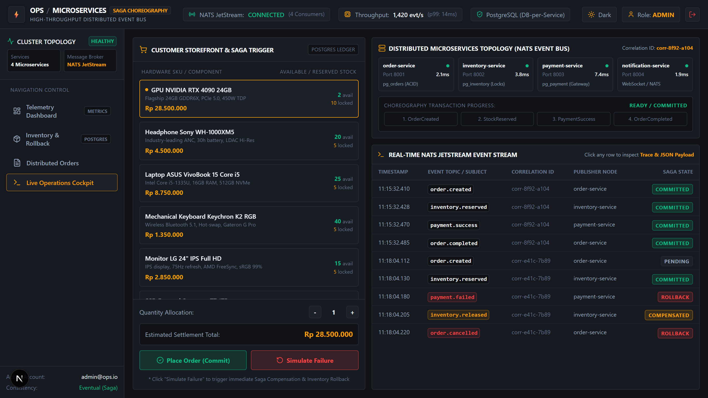
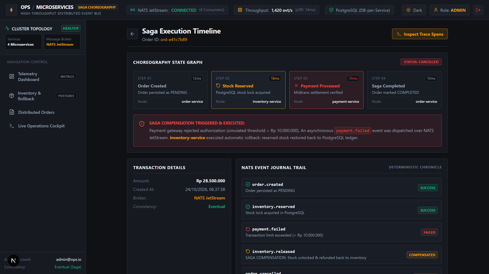
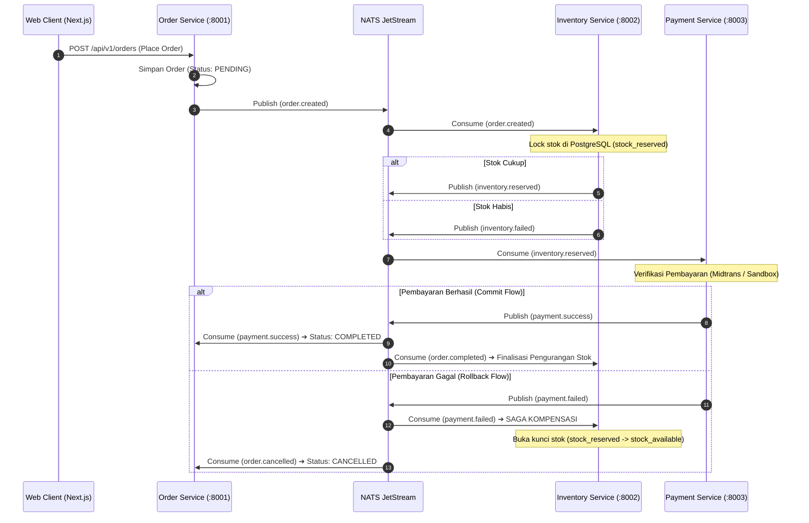

# Order Processing System - Distributed Microservices (Backend)

Backend berkinerja tinggi (*High-Throughput Distributed Microservices*) untuk sistem pemrosesan pesanan terdistribusi dengan pola **Saga Choreography**. Dibangun menggunakan Go (Golang), Fiber, NATS JetStream, PostgreSQL (*Database-per-Service*), gRPC, Docker, dan terintegrasi dengan Payment Gateway Midtrans.

---

## 📸 Antarmuka Observabilitas & Saga Preview

| Preview Antarmuka | Deskripsi Fitur & Rekayasa Sistem |
|---|---|
|  | **Live Operations Cockpit & Storefront**<br/>Simulasi transaksi real-time dengan tombol *Place Order* (Commit Flow) dan *Simulate Failure* (Rollback Flow) yang memicu kompensasi stok secara instan. |
|  | **Saga Execution Timeline UI**<br/>Visualisasi alur langkah transaksi terdistribusi, durasi latensi per span (OpenTelemetry), serta penanganan kompensasi rollback inventaris otomatis. |
|  | **Real-time Order Monitoring Dashboard**<br/>Konsol observabilitas terpusat: metrik throughput event NATS JetStream (1.420 evt/s), rasio keberhasilan Saga (98.4%), dan status cluster. |
|  | **Inventory Reservation & Rollback UI**<br/>Audit log database PostgreSQL terisolasi: pelacakan *Available Stock* vs *Reserved Stock (Saga Locks)* dan pencegahan *stock race condition*. |
|  | **Login Mode Terang (Light Mode)**<br/>Antarmuka berstandar enterprise dengan palet Titanium Canvas dan tipografi monospace berdensitas tinggi. |
|  | **Login Mode Gelap (Dark Mode)**<br/>Palet Titanium Gunmetal & Industrial Amber dengan rasio kontras tinggi dan telemetry metadata status cluster. |

---

## 🏗️ Clean Architecture & Struktur Modul Backend

Backend menerapkan prinsip **Clean Architecture & Separation of Concerns** pada setiap microservice:
1. **Presentation Layer (`internal/handler`)**: Fiber HTTP handlers, router endpoints, middleware autentikasi JWT stateless, dan CORS handler.
2. **Application Layer (`internal/service`)**: Domain business logic, Saga orchestration flow, kalkulasi saldo, dan validasi transaksi.
3. **Domain Layer (`pkg/events`, `internal/repository/models.go`)**: Entitas inti, kontrak event payload, subjek NATS JetStream, dan model status transaksi.
4. **Infrastructure Layer (`internal/repository`, `pkg/natsclient`, `pkg/postgres`)**: Implementasi akses database PostgreSQL via connection pool, query SQLC, dan pub/sub NATS JetStream client.

---

## ⚡ Alur Saga Choreography & Kompensasi Rollback



---

## 🛠️ Tech Stack & Spesifikasi

- **Bahasa & Framework**: Go (Golang 1.22+), Fiber v2
- **Message Broker**: NATS JetStream (Pub/Sub terjamin, At-least-once delivery, Deduplication)
- **Database**: PostgreSQL 16 dengan pola **Database-per-Service** (4 Database terisolasi: `order_db`, `inventory_db`, `payment_db`, `notification_db`)
- **Protokol Komunikasi**: REST API (HTTP/2), gRPC (High-speed inter-service query), Protocol Buffers
- **Observabilitas**: OpenTelemetry Distributed Tracing spans, Structured JSON Logging (zerolog)
- **Containerization**: Docker & Docker Compose

---

## 🚀 Menjalankan Backend Secara Lokal

```bash
# 1. Jalankan cluster NATS JetStream & PostgreSQL
docker-compose up -d nats postgres-order postgres-inventory postgres-payment postgres-notification

# 2. Jalankan test otomatis microservices
cd services/order-service && go test ./...
cd ../inventory-service && go test ./...
cd ../payment-service && go test ./...
cd ../notification-service && go test ./...
```
