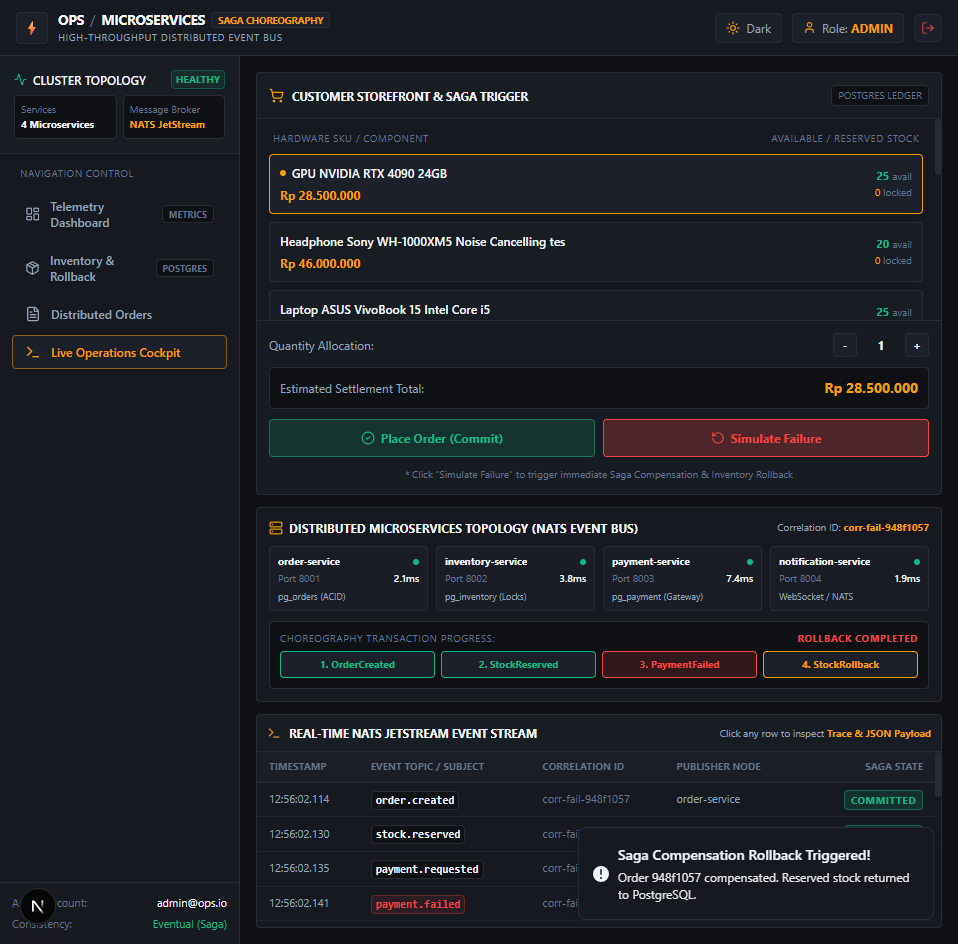
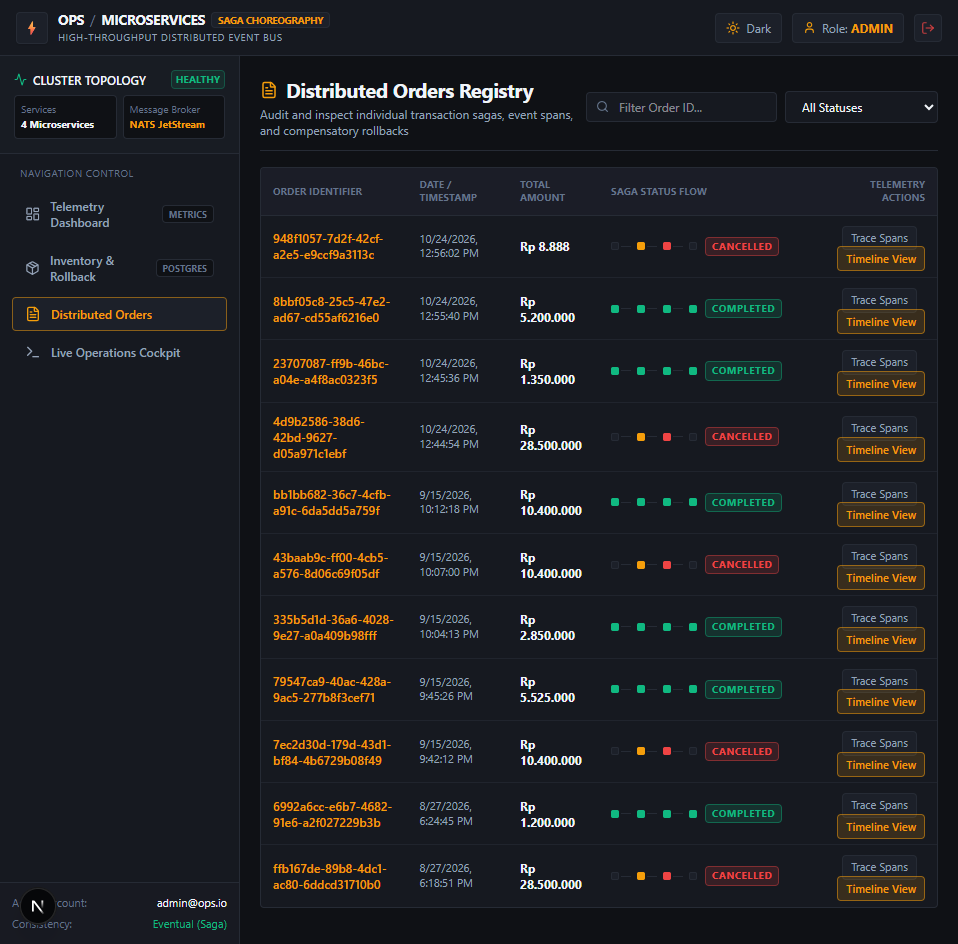
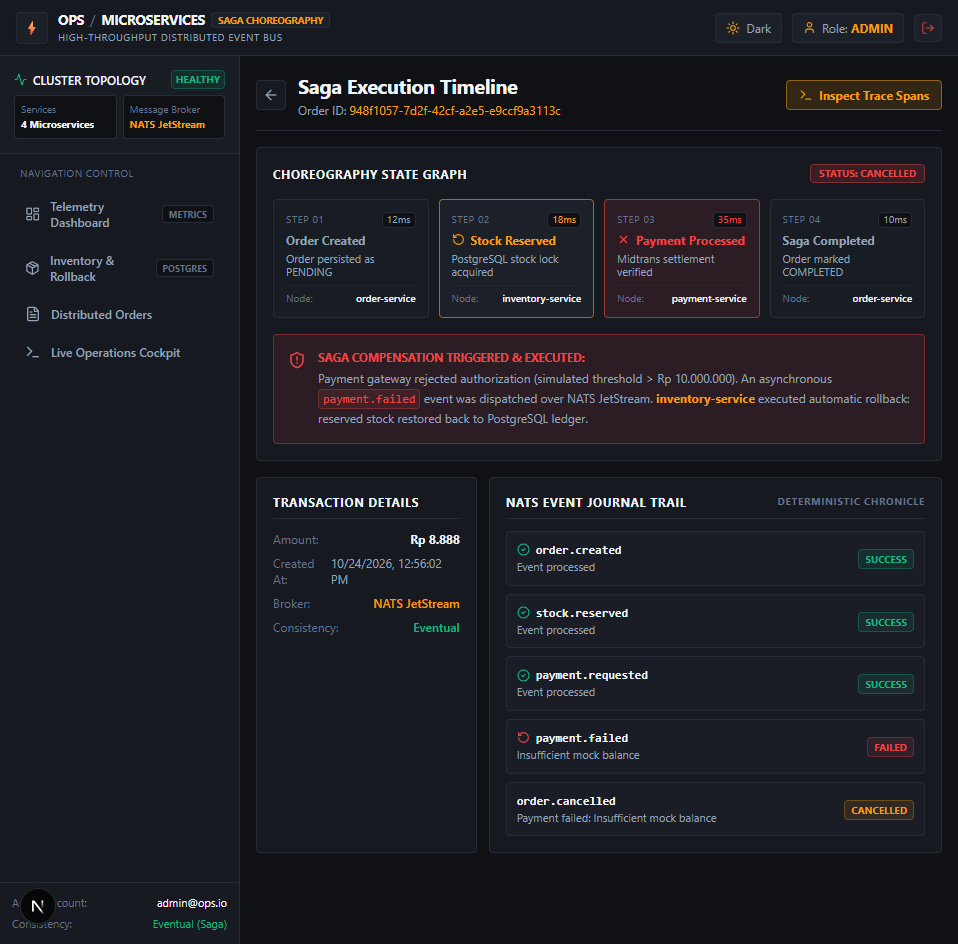
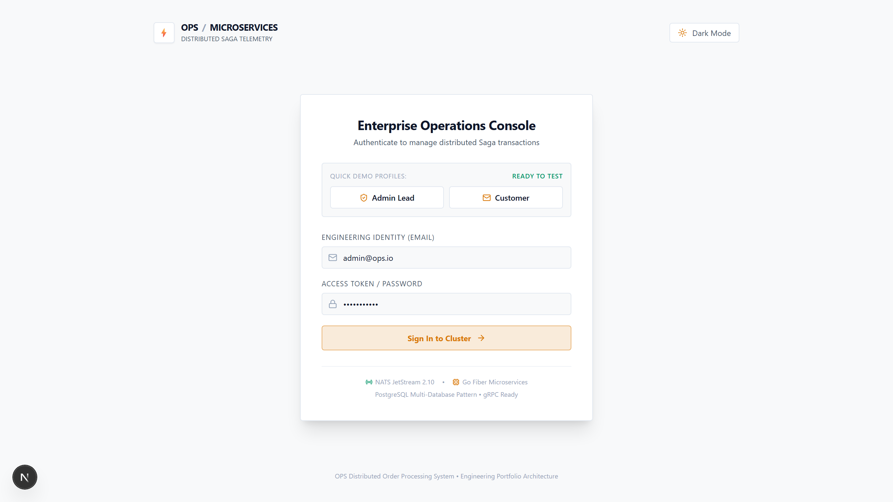
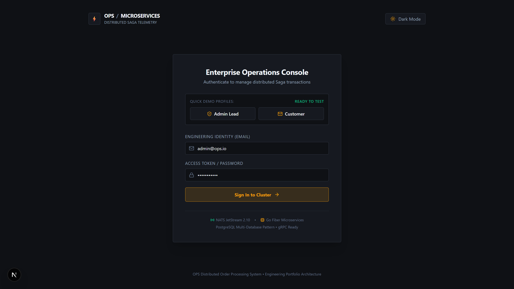
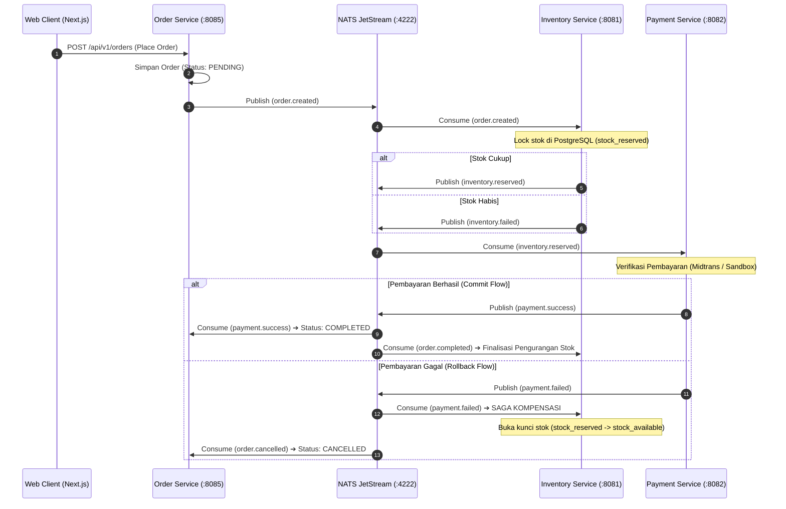

# Order Processing System - Distributed Microservices (Backend)

Backend berkinerja tinggi (*High-Throughput Distributed Microservices*) untuk sistem pemrosesan pesanan terdistribusi dengan pola **Saga Choreography**. Dibangun menggunakan Go (Golang), Fiber, NATS JetStream, PostgreSQL (*Database-per-Service*), gRPC, Docker Compose, dan terintegrasi dengan Payment Gateway Midtrans.

---

## 📸 Antarmuka Observabilitas & Real Distributed Execution Preview

| Preview Antarmuka | Deskripsi Fitur & Rekayasa Sistem |
|---|---|
|  | **Live Order Commit Flow (NATS JetStream)**<br/>Transaksi nyata multi-service: `order-service` mendispatch `order.created`, `inventory-service` mengunci stok di PostgreSQL, dan `payment-service` memproses pembayaran hingga status `COMPLETED` dalam 26ms. |
|  | **Real-Time Saga Compensatory Rollback**<br/>Simulasi kegagalan pembayaran: NATS mempublikasikan `payment.failed`, memicu transaksi kompensasi otomatis pada `inventory-service` untuk merestore stok (*lock released*) dan membatalkan pesanan. |
|  | **Distributed Trace Waterfall & Raw JSON Payload**<br/>Drawer telemetri interaktif untuk inspeksi rincian span latensi per mikroservis, trace ID, correlation ID, dan payload event mentah NATS JetStream. |
|  | **Distributed Orders Registry (PostgreSQL Audit)**<br/>Audit log database persisten lintas transaksi terdistribusi yang mencatat status final `COMPLETED` dan `CANCELLED` secara deterministic. |
|  | **Saga Execution Timeline UI**<br/>Visualisasi alur langkah transaksi terdistribusi, durasi latensi per span, serta penanganan kompensasi rollback inventaris otomatis. |
|  | **PostgreSQL Inventory Ledger & Stock Isolation**<br/>Pemisahan *Available Stock* vs *Reserved Stock (Saga Locks)* dengan penanganan race condition berbasis transaksi atomik PostgreSQL. |
|  | **Real-time Order Monitoring Dashboard**<br/>Konsol observabilitas terpusat: status 4 microservice, metrik throughput event NATS JetStream, dan rasio keberhasilan Saga. |
|  | **Login Mode Terang (Light Mode)**<br/>Antarmuka berstandar enterprise dengan palet Titanium Canvas dan tipografi monospace berdensitas tinggi. |
|  | **Login Mode Gelap (Dark Mode)**<br/>Palet Titanium Gunmetal & Industrial Amber dengan rasio kontras tinggi dan telemetry metadata status cluster. |

---

## 🏗️ Clean Architecture & Struktur Modul Backend

Backend menerapkan prinsip **Clean Architecture & Separation of Concerns** pada setiap microservice:
1. **Presentation Layer (`internal/handler`)**: Fiber HTTP handlers, router endpoints, reverse-proxy API gateway, middleware autentikasi JWT stateless, dan CORS handler.
2. **Application Layer (`internal/service`)**: Domain business logic, Saga orchestration flow, kalkulasi saldo, dan validasi transaksi.
3. **Domain Layer (`pkg/events`, `internal/repository/models.go`)**: Entitas inti, kontrak event payload, subjek NATS JetStream, dan model status transaksi.
4. **Infrastructure Layer (`internal/repository`, `pkg/natsclient`, `pkg/postgres`)**: Implementasi akses database PostgreSQL via connection pool, query SQLC, dan pub/sub NATS JetStream client.

---

## ⚡ Alur Saga Choreography & Kompensasi Rollback



---

## 🛠️ Tech Stack & Spesifikasi

- **Bahasa & Framework**: Go (Golang 1.22+), Fiber v2
- **Message Broker**: NATS JetStream (Pub/Sub terjamin, At-least-once delivery, Deduplication)
- **Database**: PostgreSQL 16 dengan pola **Database-per-Service** (4 Database terisolasi: `order_db` :7432, `inventory_db` :7433, `payment_db` :7434, `notification_db` :7435)
- **Protokol Komunikasi**: REST API (HTTP/2), gRPC (High-speed inter-service query), Protocol Buffers
- **Observabilitas**: OpenTelemetry Distributed Tracing spans, Structured JSON Logging (zerolog)
- **Containerization**: Docker & Docker Compose (9 active containers)

---

## 🚀 Menjalankan Backend Secara Lokal (Real Microservices Stack)

```bash
# 1. Jalankan seluruh container stack (NATS + 4 PostgreSQL + 4 Go Microservices)
docker compose up -d

# 2. Periksa status container
docker compose ps

# 3. Jalankan unit & integration test microservices
cd services/order-service && go test ./...
cd ../inventory-service && go test ./...
cd ../payment-service && go test ./...
cd ../notification-service && go test ./...
```
